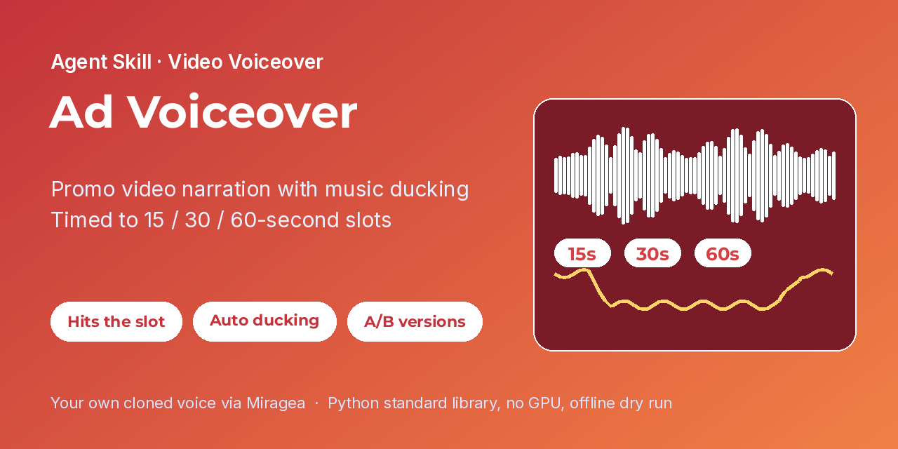
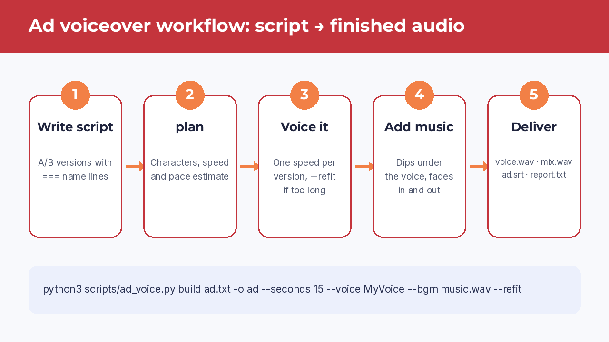

# 广告配音



广告配音是一个把广告词和宣传片解说稿按目标秒数配成成品音轨的 Agent 技能：给电商、品牌和企业宣传的视频制作者用，自动算语速卡准 15 / 30 / 60 秒，用你自己的克隆音色生成人声，叠加背景音乐并在说话时自动压低，一次出多个 A/B 版本，本地无需显卡。

- 广告稿 TXT（多版本用 `=== 版本名` 分开）→ 每版 `voice.wav` + `mix.wav` + `ad.srt` + `report.txt`
- `--seconds 15`：按目标时长统一算语速，`plan` 离线预估字数和语速，`--refit` 实测超时自动重配一次
- `--bgm 音乐.wav`：背景音乐循环铺满、说话时自动压低（`--duck`）、片头片尾渐入渐出；`mix` 可单独混音



## 安装

把本文件夹 `ad-voiceover/` 复制到 Agent 的 skills 目录（如 `~/.claude/skills/`、`~/.codex/skills/`），或在技能市场一键安装。完整用法、工作流和 FAQ 见 [SKILL.md](./SKILL.md)。

```bash
python3 scripts/ad_voice.py selftest     # 离线自检，不需要 Key
python3 scripts/ad_voice.py plan examples/ad_script.txt --seconds 15
```

正式生成需要 Python 3.9+、环境变量 `MIRAGEA_API_KEY` 和账号里你自己的角色（Miragea：https://miragea.ai）。
