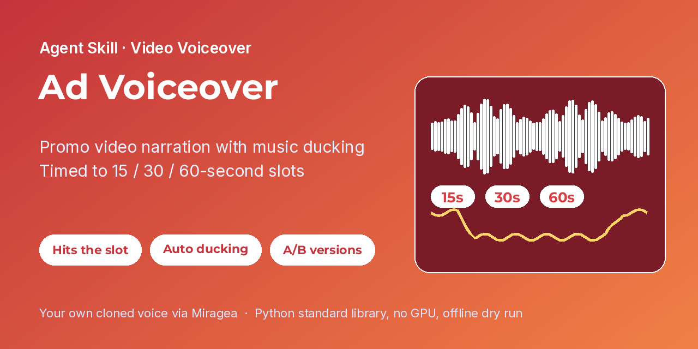
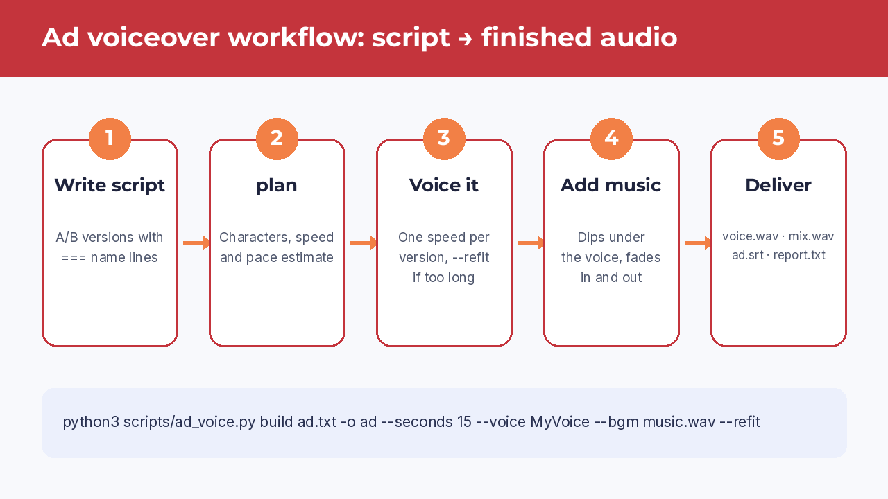

# 广告配音



广告配音是一个把广告词和宣传片解说稿按目标秒数配成成品音轨的 Agent 技能：给电商、品牌和企业宣传的视频制作者用，自动算语速卡准 15 / 30 / 60 秒，用你自己的克隆音色生成人声，叠加背景音乐并在说话时自动压低，一次出多个 A/B 版本，本地无需显卡。

## 一句话定义

广告配音 = 广告稿（可写多个版本）→ `ad_voice.py build --seconds 15 --bgm 音乐.wav` → 按目标秒数算好语速的人声 + 说话时自动压低的背景音乐 → 每版 `voice.wav`、`mix.wav`、`ad.srt`、`report.txt`。

## 适用人群与场景

| 谁在用 | 典型场景 |
|---|---|
| 电商运营、投放优化师 | 同一款商品写 2–3 个开场，一次生成 A/B 测试版本，卡准 15 秒 / 30 秒信息流位 |
| 品牌、企业宣传片制作 | 解说稿按成片时长配音，配上授权背景音乐，审片版当天出 |
| 门店、本地生活商家 | 新品、活动推广口播，改一句只重配一句 |
| 短视频剪辑师 | 先拿到恰好等于目标秒数的成品音轨，再进剪映 / PR 对画面 |

## 输入 → 输出

| 输入 | 输出（每个版本一个文件夹） |
|---|---|
| `广告稿.txt`：每行一两句；空行是短换气（`--gap`）；单独一行 `[停顿 0.5]` 是固定停顿；`#` 开头是备注；多版本用单独一行 `=== 版本名` 分开 | `voice.wav`：片头留白 + 人声 + 片尾留白，总长等于 `--seconds` |
| `--seconds 15`：成片目标秒数 | `mix.wav`：加了 `--bgm` 时输出，人声 + 自动压低的背景音乐 |
| `--bgm 音乐.wav`：你自有或已授权的音乐（PCM WAV） | `ad.srt`：逐句字幕；`report.txt`：语速、字数、实测每分钟字数、是否超时 |
| `--voice 角色名称` 或 `--actor-id` | `OUT/report.txt`：所有版本一览（时长、语速、合格 / 超时） |

## 能力一览

| 项目 | 说明 |
|---|---|
| 卡时长 | 目标秒数减去片头 `--intro`（默认 0.5 秒）、片尾 `--outro`（默认 1 秒）和固定停顿，按粗估朗读时长算出一个统一语速，限制在 `--min-speed`（默认 0.8）到 `--max-speed`（默认 1.35）之间；稿子太长会提示删到大约多少字 |
| 实测校准 | 正式生成后量真实时长；`--refit` 时人声超出就按修正后的语速重配一次；`report.txt` 给出实测语速，下次用 `--cps` 让预估更准 |
| 背景音乐 | 读 PCM WAV，循环铺满到成品长度；`--bgm-gain`（默认 -14 dB）定音乐相对音量，`--duck`（默认 10 dB）为说话时额外压低的量，起落平滑；`--fade-in` / `--fade-out` 渐入渐出 |
| 多版本 | `=== 版本名` 分隔，一次生成全部版本，文件夹按版本名命名 |
| 增量 | 每句按“文字 + 音色 + 语速”缓存在 `cache/`，改一句只重配这一句；断网后重跑续做 |
| 单独混音 | `mix 人声.wav --bgm 音乐.wav -o 成品.wav`：给任何已有人声加背景音乐和自动压低 |
| 本地依赖 | Python 3.9+ 标准库，无需显卡；输出单声道 WAV |

## 快速开始

先离线试跑（不需要 Key、不联网；`demo-bgm` 用脚本合成一段和弦铺底，只用来试混音）：

```bash
python3 scripts/ad_voice.py selftest
python3 scripts/ad_voice.py plan examples/ad_script.txt --seconds 15
python3 scripts/ad_voice.py demo-bgm test_bgm.wav --seconds 20
python3 scripts/ad_voice.py build examples/ad_script.txt -o ad --seconds 15 --voice 默认 --bgm test_bgm.wav --dry-run
```

正式生成需要 Miragea 的 API Key 和账号里你自己的角色（https://miragea.ai）：

```bash
export MIRAGEA_API_KEY=你的key                       # 在 https://miragea.ai/workspace/api 生成，只放环境变量，不要贴进聊天
python3 scripts/miragea_audio.py capabilities        # 当前可用模式、语气标签、单句字数上限和计费，以实时返回为准
python3 scripts/miragea_audio.py actors --limit 20   # 账号里已有的角色（名称、actor_id、语言）
# 还没有自己的角色：用本人或已获授权的 3–60 秒清晰录音创建一个私有角色（会按账号规则计费）
python3 scripts/miragea_audio.py create-actor --file 我的录音.wav --name 我的声音 --language zh
```

- Default API root is `https://miragea.ai/v1`; set `MIRAGEA_BASE_URL` (including `/v1`) only for a private deployment.
- 接口只按角色配音：`--voice 角色名称`（脚本让官方客户端按名称精确匹配）或 `--actor-id 角色ID`。旧的“参考音频 URL 直接克隆”入口服务端已移除，本技能不使用。
- 没有 Key 时所有命令都可以先加 `--dry-run` 离线跑通；不加 `--dry-run` 又没有 Key 时，脚本给出中文提示并以退出码 2 结束，不会调用接口。

```bash
python3 scripts/ad_voice.py build 我的广告.txt -o ad --seconds 15 --voice 我的声音 --bgm 我的配乐.wav --refit
python3 scripts/ad_voice.py build 宣传片解说.txt -o promo --seconds 60 --voice 我的声音 --intro 2 --outro 3 --bgm 我的配乐.wav --duck 12
```

## 分步工作流



1. **写稿**：每行一两句，开场先抛钩子；要测多个开场就用 `=== A版`、`=== B版` 分开。
2. **预估**：`plan 稿子.txt --seconds 15`，看每个版本的字数、建议语速和每分钟字数；提示“稿子偏长”就按建议字数删减。
3. **试听**：先只放一个版本、两三句正式生成，确认音色和语气。
4. **整稿生成**：`build ... --seconds 15 --voice 我的声音 --refit`；加 `--bgm` 同时出混音版。
5. **看报告**：打开每版 `report.txt`，“超时”就删字或调高 `--max-speed`；把实测语速填进 `--cps`，下次预估更准。
6. **进剪辑**：`mix.wav` 直接放进剪映 / PR 时间线，`ad.srt` 导入做字幕；只要人声就用 `voice.wav`。

## 你说什么 → Agent 执行

| 你说 | Agent 执行 |
|---|---|
| “把这段广告词配成 15 秒的” | `plan --seconds 15` 预估 → `build --seconds 15 --refit` |
| “再写两个开场一起测” | 稿子里加 `=== B版`、`=== C版`，一次生成 |
| “音乐太吵 / 太小” | 调 `--bgm-gain`（音乐整体）或 `--duck`（说话时压低多少） |
| “宣传片 60 秒，前面留 2 秒音乐” | `--seconds 60 --intro 2 --outro 3` |
| “只改了最后一句” | 改稿后重跑，只重配改过的句子 |
| “人声已经有了，帮我加背景音乐” | `mix 人声.wav --bgm 音乐.wav -o 成品.wav` |

## dry-run 实际输出

```text
$ python3 scripts/ad_voice.py selftest
selftest ok（解析、卡时长、混音压低、dry-run 生成全部通过，未联网）

$ python3 scripts/ad_voice.py plan examples/ad_script.txt --seconds 15
[A版_痛点开场] 47 字，正常语速朗读约 11.2 秒；目标 15 秒（片头 0.5 + 人声 13.5 + 片尾 1.0）→ 建议语速 0.85，约每分钟 214 字
[B版_福利开场] 49 字，正常语速朗读约 11.7 秒；目标 15 秒（片头 0.5 + 人声 13.5 + 片尾 1.0）→ 建议语速 0.91，约每分钟 230 字
（按每秒 4.2 字粗估；正式生成后 report.txt 给出实测语速，可用 --cps 校准）

$ python3 scripts/ad_voice.py demo-bgm test_bgm.wav --seconds 20
已生成测试用背景音乐 test_bgm.wav（20 秒，脚本合成的和弦铺底，仅用于试跑混音）

$ python3 scripts/ad_voice.py build examples/ad_script.txt -o ad --seconds 15 --voice 默认 --bgm test_bgm.wav --dry-run
[A版_痛点开场] 3 句 → ad/A版_痛点开场/  成品 15.00 秒，语速 0.85（含 mix.wav）
[B版_福利开场] 3 句 → ad/B版_福利开场/  成品 15.02 秒，语速 0.91（含 mix.wav）
[dry-run：占位提示音，未调用接口；时长按粗估语速计算]
```

## 示例广告稿（examples/ad_script.txt，原创，品牌为虚构）

```text
# 15 秒电商广告，两个开场做 A/B 测试（原创示例，品牌为虚构）
=== A版_痛点开场
冬天一出门，手就冻得发僵？
暖小蜂充电暖手宝，三档温度，握在手里刚刚好，出门通勤都能用。

现在下单，明天就能到家。
=== B版_福利开场
今年冬天，送自己一份暖。
暖小蜂充电暖手宝，三档温度，还能给手机应急充电，小巧不占地方。

[停顿 0.4]
点击下方链接，把温暖带回家。
```

## 和常见做法的区别

| 对比项 | 网页配音再进剪辑软件加音乐 | 找配音员录 | 本技能 |
|---|---|---|---|
| 卡时长 | 反复改字、改语速试 | 靠配音员现场控制 | 按目标秒数算语速，实测超时自动重配 |
| 背景音乐压低 | 手动画音量包络 | 后期另做 | 说话处自动压低，起落平滑 |
| 多版本 A/B | 每版重新操作 | 每版重录 | 一个稿子写多版，一次全出 |
| 改一句 | 整段重做 | 约棚补录 | 只重配改过的句子 |
| 声音 | 通用音色 | 配音员 | 账号里你自己的克隆音色 |

## 常见问题（FAQ）

**广告配音怎么制作？**
写好广告稿，`plan` 预估语速，`build --seconds 目标秒数 --voice 你的角色` 生成人声，加 `--bgm` 同时得到配好背景音乐的 `mix.wav`。

**宣传片配音一分钟读多少字合适？**
没有统一标准，和音色、风格、画面节奏有关。`plan` 会按粗估语速算出每分钟字数，正式生成后 `report.txt` 给出实测值，以实测为准再删改稿子。

**宣传片配音语速怎么定？**
由目标时长反推：稿子字数固定时，`--seconds` 越短语速越快。脚本把语速限制在 `--min-speed` 和 `--max-speed` 之间，超出范围就提示删字，而不是把人声压得过快。

**配音加背景音乐怎么弄？**
`build` 时加 `--bgm 音乐.wav`，或对已有人声用 `mix`。音乐循环铺满，说话时自动压低 `--duck` 分贝，结尾渐出。

**背景音乐的音量比例怎么调？**
`--bgm-gain` 控制音乐整体相对人声的音量（默认 -14 dB），`--duck` 控制说话时额外压低多少（默认 10 dB）；先用默认值试听，再按 2–3 dB 一档微调。

**广告配音软件有免费版吗？**
本技能脚本是开源的（MIT），`--dry-run` 和 `plan`、`mix` 都可以离线免费使用；正式生成人声会调用 Miragea 接口，按账号规则计费，以 `capabilities` 实时返回为准。

**能用 MP3 背景音乐吗？**
脚本只读 PCM WAV。先转换：`ffmpeg -i music.mp3 music.wav`。

**能生成背景音乐吗？**
不能。`demo-bgm` 只是用于试跑的简单和弦铺底；正式成片请用你自有或已获授权的音乐。

## 出问题了？

| 现象 | 处理 |
|---|---|
| `未设置环境变量 MIRAGEA_API_KEY` | `export MIRAGEA_API_KEY=...`，或先加 `--dry-run` |
| `还没有指定音色` | 加 `--voice 角色名称` 或 `--actor-id`；没有角色先 `create-actor` |
| `actor_not_found` / `ambiguous_actor_name` | 名称要和 `actors` 列表完全一致；同名角色改用 `--actor-id` |
| 401 / 403 | 检查 Key 和账号的 API 访问权限；不要把 Key 写进日志 |
| 400 / 413 | 修正参数：模式、语气标签、语速、单句字数；超长句子会被自动在标点处切短 |
| 429 | 额度不足或限流，稍后再试或补充额度 |
| 中途断网 / 超时 | 直接重跑同一条命令：已生成的句子在 `cache/` 里复用，同一句用同一个幂等键，服务端返回原任务，不重复计费创建 |

脚本退出码：0 成功；2 输入或环境问题（中文提示）。官方客户端：0 请求成功，1 任务失败，2 客户端或接口错误。

## 限制与注意事项

- 只生成人声并做混音；不生成背景音乐、音效，不做变声，不做视频剪辑。
- 时长预估按字数粗估；成品时长以 `report.txt` 和实际文件为准。人声超出目标时不会被裁掉，报告会标“超时”。
- 背景音乐只支持 PCM WAV，输出为单声道 WAV。
- 广告内容需符合《广告法》和投放平台规则，不写绝对化用语和无法证明的功效；版权音乐须有授权。
- `--dry-run` 输出占位提示音，只用于检查流程和时长。

## 合规与 AI 生成内容标识

- 只用你本人或已获书面授权的声音创建角色和配音，不模仿他人声音；不得用于冒充、诈骗或误导。
- 按《人工智能生成合成内容标识办法》和各平台规则，在需要的场合标注 AI 生成内容。
- `scripts/miragea_audio.py` is the official client 1.3.0, shipped unchanged；`scripts/audio_kit.py` 和本技能主脚本为原创，MIT 许可（见 `LICENSE.txt`）。

## English Summary

- **Ad voiceover in one command**: ad script (several A/B versions separated by `=== name`) → `ad_voice.py build --seconds 15 --bgm music.wav` → per version `voice.wav`, `mix.wav`, `ad.srt`, `report.txt`.
- **Hits the slot**: one speaking speed per version is worked out from the target length (15 / 30 / 60 s); `--refit` regenerates once if the real voice runs long.
- **Music ducking**: your own or licensed WAV music bed is looped, dipped under the voice (`--duck`), faded in and out; `mix` does the same for any existing voice track.
- Uses your own cloned voice from your account. Local requirements: Python 3.9+ standard library only, no GPU, no pip install. Every command has an offline `--dry-run` (no key, no network).

**关键词**：广告配音、宣传片配音、配音加背景音乐、企业宣传片配音、AI广告配音、电商广告配音、背景音乐自动压低、声音克隆、AI配音、ad voiceover、promo video voiceover、background music ducking
