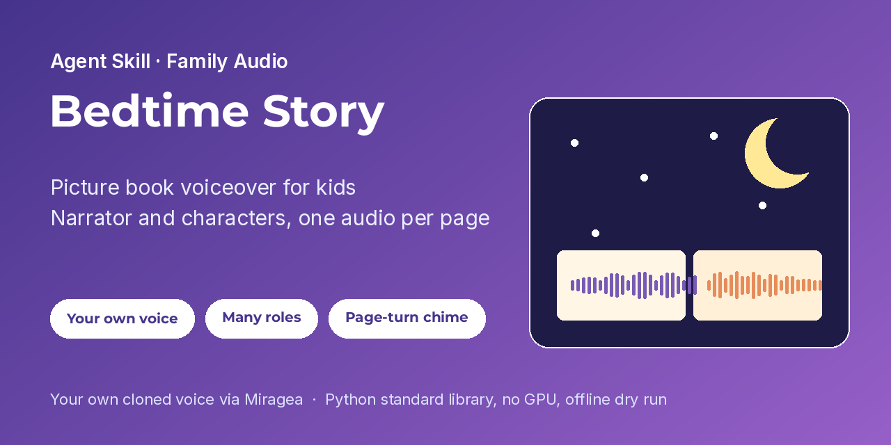
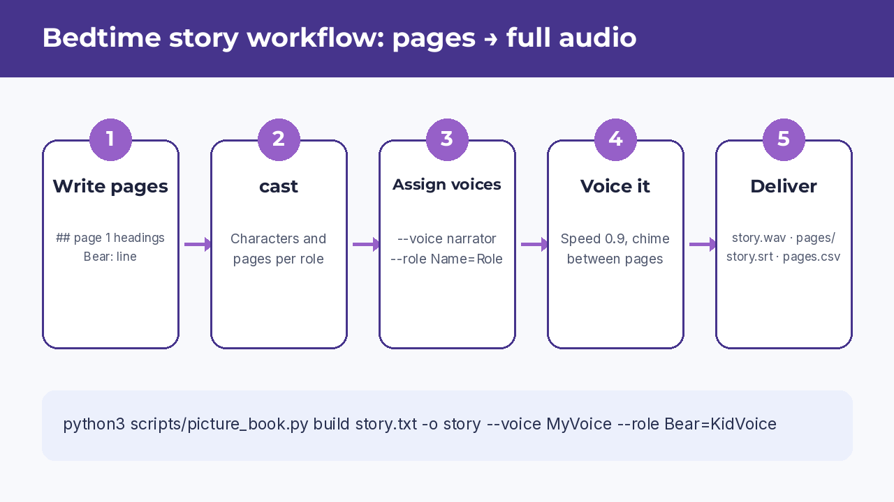

# 睡前故事



睡前故事是一个把按页写好的绘本和儿童故事配成整本音频的 Agent 技能：给想用自己声音给孩子讲故事的家长、做绘本音频的老师和博主用，旁白和角色可用不同音色，每页单独出音频并自动加翻页提示音，输出字幕和每页时长表，本地无需显卡。

- 故事 TXT（`## 第1页` 分页，`小熊：台词` 标角色）→ `story.wav` + `pages/pageNN.wav` + `story.srt` + `pages.csv`
- `--role 小熊=角色名称`：旁白和每个角色分配不同的账号角色；没分配的角色用旁白音色；`cast` 先看角色统计
- 默认语速 0.9 偏慢，页间翻页提示音（`--no-chime` 可关）和停顿；改一页只重配改过的句子



## 安装

把本文件夹 `bedtime-story-picture-book/` 复制到 Agent 的 skills 目录（如 `~/.claude/skills/`、`~/.codex/skills/`），或在技能市场一键安装。完整用法、工作流和 FAQ 见 [SKILL.md](./SKILL.md)。

```bash
python3 scripts/picture_book.py selftest     # 离线自检，不需要 Key
python3 scripts/picture_book.py cast examples/story.txt
```

正式生成需要 Python 3.9+、环境变量 `MIRAGEA_API_KEY` 和账号里你自己的角色（Miragea：https://miragea.ai）。
