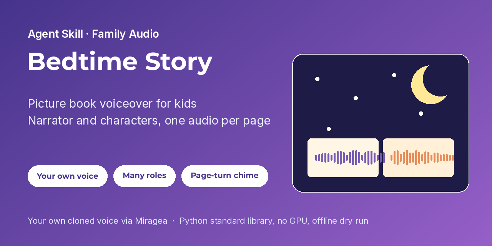
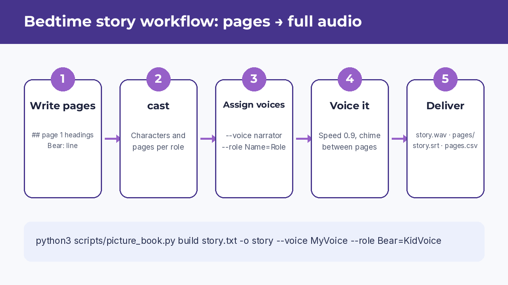

# 睡前故事



睡前故事是一个把按页写好的绘本和儿童故事配成整本音频的 Agent 技能：给想用自己声音给孩子讲故事的家长、做绘本音频的老师和博主用，旁白和角色可用不同音色，每页单独出音频并自动加翻页提示音，输出字幕和每页时长表，本地无需显卡。

## 一句话定义

睡前故事配音 = 按页写好的故事文本 → `picture_book.py build --role 小熊=角色名称` → 旁白和角色各用自己的音色，每页一个音频，页间有翻页提示音 → `story.wav`、`pages/pageNN.wav`、`story.srt`、`pages.csv`。

## 适用人群与场景

| 谁在用 | 典型场景 |
|---|---|
| 想用自己声音讲故事的家长 | 出差、加班时用自己的克隆音色给孩子留一本睡前故事，旁白和角色可以用不同的声音 |
| 幼儿园、早教老师 | 把绘本做成按页播放的音频，配合课件翻页，每页一个文件 |
| 绘本博主、儿童故事自媒体 | 整本音频 + 字幕交给剪辑软件做视频，改一页只重配一页 |
| 做亲子 App、点读内容的人 | 每页 `pageNN.wav` 和 `pages.csv` 直接对接页面 |

## 输入 → 输出

| 输入 | 输出 |
|---|---|
| `故事.txt`：`## 第1页` 分页；`角色名：台词` 是角色台词；其他行是旁白；单个 `#` 开头是标题或备注 | `story.wav`：整本故事，页间有翻页提示音和停顿 |
| `--voice 角色名称`：旁白音色（或 `--actor-id`） | `pages/page01.wav`、`page02.wav`……：每页一个文件 |
| `--role 小熊=角色名称`（可重复）：给角色分配账号里的角色 | `story.srt`：逐句字幕；`pages.csv`：每页起点、时长、句数 |
| `--speed 0.9`：语速，0.25–4，默认 0.9 | `cache/`：按句缓存，改一页只重配改过的句子 |

## 能力一览

| 项目 | 说明 |
|---|---|
| 分页与角色 | `## 第N页` 分页；`角色名：台词` 识别角色（中英文冒号都行）；没有标角色的行是旁白 |
| 多音色 | 旁白用 `--voice`，每个角色用 `--role`；没分配的角色自动用旁白音色；每次运行每个角色只解析一次 |
| 翻页提示音 | 页与页之间加一声轻柔的两音提示（脚本本地合成，不依赖音效文件），`--no-chime` 关闭，`--page-gap` 调停顿 |
| 慢语速 | 默认 `--speed 0.9`，`--line-gap` 调句间停顿，适合睡前听 |
| 字幕和时长表 | `story.srt` 逐句字幕，角色台词前带角色名；`pages.csv` 记录每页起点和时长 |
| 增量 | 每句按“文字 + 音色 + 语速”缓存，改一页后重跑只重配改过的句子；断网后重跑续做 |
| 本地依赖 | Python 3.9+ 标准库，无需显卡；输出单声道 WAV |

## 快速开始

先离线试跑（不需要 Key、不联网）：

```bash
python3 scripts/picture_book.py selftest
python3 scripts/picture_book.py cast examples/story.txt
python3 scripts/picture_book.py plan examples/story.txt
python3 scripts/picture_book.py build examples/story.txt -o story --voice 默认 --role 小熊=默认 --dry-run
```

正式生成需要 Miragea 的 API Key 和账号里你自己的角色（https://miragea.ai）：

```bash
export MIRAGEA_API_KEY=你的key                       # 在 https://miragea.ai/workspace/api 生成，只放环境变量，不要贴进聊天
python3 scripts/miragea_audio.py capabilities        # 当前可用模式、语气标签、单句字数上限和计费，以实时返回为准
python3 scripts/miragea_audio.py actors --limit 20   # 账号里已有的角色（名称、actor_id、语言）
# 还没有自己的角色：用本人或已获授权的 3–60 秒清晰录音创建一个私有角色（会按账号规则计费）
python3 scripts/miragea_audio.py create-actor --file 我的录音.wav --name 我的声音 --language zh
```

- Default API root is `https://miragea.ai/v1`; set `MIRAGEA_BASE_URL` (including `/v1`) only for a private deployment.
- 接口只按角色配音：`--voice 角色名称`（脚本让官方客户端按名称精确匹配）或 `--actor-id 角色ID`。旧的“参考音频 URL 直接克隆”入口服务端已移除，本技能不使用。
- 没有 Key 时所有命令都可以先加 `--dry-run` 离线跑通；不加 `--dry-run` 又没有 Key 时，脚本给出中文提示并以退出码 2 结束，不会调用接口。

```bash
python3 scripts/picture_book.py build 我的故事.txt -o story --voice 我的声音
python3 scripts/picture_book.py build 我的故事.txt -o story --voice 我的声音 --role 小熊=童声角色 --role 熊妈妈=妈妈角色 --speed 0.85
```

## 分步工作流



1. **写故事**：每页 2–5 句，用 `## 第1页` 分页；台词写成 `小熊：……`，其余是旁白。
2. **看角色**：`cast 故事.txt` 查看有几个角色、每个角色多少字、出现在哪几页。
3. **预估**：`plan 故事.txt` 粗估每页和全书时长，睡前故事建议先确认总长。
4. **试听**：先只放前两页正式生成，确认旁白音色和语速。
5. **整本生成**：`build 故事.txt -o story --voice 旁白角色 --role 角色名=账号角色`。
6. **交付**：`story.wav` 直接播放或导入剪辑；`pages/` 对接课件或 App；`story.srt` 做字幕。

## 你说什么 → Agent 执行

| 你说 | Agent 执行 |
|---|---|
| “用我的声音讲一个睡前故事” | 写按页故事 → `build --voice 我的声音` |
| “小熊用孩子的声音，妈妈用我的声音” | `--voice 妈妈角色 --role 小熊=童声角色` |
| “再慢一点” | `--speed 0.8`，重跑只重配语速变化的句子 |
| “第三页改一句” | 改稿后重跑，其余句子复用缓存 |
| “不要翻页的叮咚声” | 加 `--no-chime` |
| “每页要单独的音频” | 已默认输出 `pages/pageNN.wav` |

## dry-run 实际输出

```text
$ python3 scripts/picture_book.py selftest
2 页 → /tmp/tmpbt9mc17v/o/（story.wav / pages/ / story.srt / pages.csv）成品约 0.2 分钟  [dry-run：占位提示音，未调用接口]
selftest ok

$ python3 scripts/picture_book.py cast examples/story.txt
共 4 页，3 个角色
旁白	6 句	97 字	出现在第 1,2,3,4 页
小熊	2 句	20 字	出现在第 1,3 页
熊妈妈	1 句	11 字	出现在第 2 页

$ python3 scripts/picture_book.py plan examples/story.txt
第1页  00:00:00  约 10 秒  3 句  夜深了，森林里静悄悄的。
第2页  00:00:11  约 7 秒  2 句  熊妈妈笑着点亮了一盏月亮灯。
第3页  00:00:19  约 8 秒  2 句  暖暖的光照在小床上，小熊打了一个
第4页  00:00:29  约 8 秒  2 句  风轻轻地吹，星星一颗一颗亮起来。
共 4 页，预计总长约 0.7 分钟（粗估，以 build 实测为准）

$ python3 scripts/picture_book.py build examples/story.txt -o story --voice 默认 --role 小熊=默认 --dry-run
4 页 → story/（story.wav / pages/ / story.srt / pages.csv）成品约 0.7 分钟  [dry-run：占位提示音，未调用接口]
```

## 示例故事（examples/story.txt，原创）

```text
# 小熊的月亮灯（原创示例）
## 第1页
夜深了，森林里静悄悄的。
小熊抱着他的小被子，怎么也睡不着。
小熊：妈妈，外面好黑呀。
## 第2页
熊妈妈笑着点亮了一盏月亮灯。
熊妈妈：别怕，月亮灯会陪着你。
## 第3页
暖暖的光照在小床上，小熊打了一个大大的哈欠。
小熊：我好像……有一点困了。
## 第4页
风轻轻地吹，星星一颗一颗亮起来。
小熊闭上眼睛，做了一个香香的梦。
```

## 和常见做法的区别

| 对比项 | 手机录音 | 网页配音工具 | 本技能 |
|---|---|---|---|
| 声音 | 家长每晚现录 | 通用音色 | 账号里你自己的克隆音色 |
| 多角色 | 一个人变声 | 逐段手动切换 | 旁白和角色按名字自动分配账号角色 |
| 分页 | 一整条录音 | 手动切分 | 自动每页一个文件加整本 |
| 改一页 | 重录 | 整段重做 | 只重配改过的句子 |
| 字幕和时长 | 无 | 常需另做 | 同时输出 SRT 和每页时长表 |

## 常见问题（FAQ）

**睡前故事音频怎么做？**
把故事按页写成 TXT，`build 故事.txt -o story --voice 你的角色` 就得到整本 `story.wav` 和每页音频；先用 `--dry-run` 离线试跑流程。

**怎么用自己的声音给孩子讲睡前故事？**
先用你本人的 3–60 秒清晰录音 `create-actor` 创建私有角色，再用 `--voice 角色名称` 配音。只用你本人或已获授权的声音。

**绘本配音怎么让不同角色用不同的声音？**
台词写成 `小熊：……`，然后 `--role 小熊=账号里的角色名称`，可以重复写多个角色；没分配的角色用旁白音色。

**儿童故事朗读语速多少合适？**
没有统一标准，和孩子年龄、故事风格有关。默认 0.9 偏慢，可用 `--speed 0.8` 再放慢，先试听两页再定。

**绘本音频怎么按页分开？**
脚本默认每页输出 `pages/pageNN.wav`，同时有整本 `story.wav` 和 `pages.csv` 记录每页起点，课件和 App 直接对接。

**页与页之间的叮咚声能关掉吗？**
能，加 `--no-chime`；`--page-gap` 可调整停顿长度。提示音由脚本本地合成，不是素材文件。

**能自动生成故事内容吗？**
脚本只负责配音，故事由你或你的 Agent 来写；示例故事是原创的，可替换成自己的稿子。

**能加背景音乐或白噪音吗？**
不能。本技能只生成人声；如需配乐，请用你自有或已授权的音乐在剪辑软件里叠加。

## 出问题了？

| 现象 | 处理 |
|---|---|
| `未设置环境变量 MIRAGEA_API_KEY` | `export MIRAGEA_API_KEY=...`，或先加 `--dry-run` |
| `还没有指定音色` | 加 `--voice 角色名称` 或 `--actor-id`；没有角色先 `create-actor` |
| `actor_not_found` / `ambiguous_actor_name` | 名称要和 `actors` 列表完全一致；同名角色改用 `--actor-id` |
| 401 / 403 | 检查 Key 和账号的 API 访问权限；不要把 Key 写进日志 |
| 400 / 413 | 修正参数：模式、语气标签、语速、单句字数；超长句子会被自动在标点处切短 |
| 429 | 额度不足或限流，稍后再试或补充额度 |
| 中途断网 / 超时 | 直接重跑同一条命令：已生成的句子在 `cache/` 里复用，同一句用同一个幂等键，服务端返回原任务，不重复计费创建 |

脚本退出码：0 成功；2 输入或环境问题（中文提示）。官方客户端：0 请求成功，1 任务失败，2 客户端或接口错误。

## 限制与注意事项

- 只生成人声，不生成背景音乐、音效或故事内容，不做变声。
- 时长预估按字数粗估，以 `build` 实际结果和 `pages.csv` 为准。
- 每个角色必须在账号里已有角色；没有可用角色时先 `create-actor`。
- 绘本和故事文本需是你自己的原创或已获授权的内容，不要用于侵权出版物的整本配音传播。
- 给儿童听的内容请家长先自行试听确认。
- `--dry-run` 输出占位提示音，只用于检查流程、页数和结构。

## 合规与 AI 生成内容标识

- 只用你本人或已获书面授权的声音创建角色和配音，不模仿他人声音；不得用于冒充、诈骗或误导。
- 按《人工智能生成合成内容标识办法》和各平台规则，在需要的场合标注 AI 生成内容。
- `scripts/miragea_audio.py` is the official client 1.3.0, shipped unchanged；`scripts/audio_kit.py` 和本技能主脚本为原创，MIT 许可（见 `LICENSE.txt`）。

## English Summary

- **Bedtime story voiceover**: a story written page by page (`## page 1`, `Bear: line`) → `picture_book.py build --role Bear=RoleName` → `story.wav`, one WAV per page, `story.srt`, `pages.csv`.
- **Narrator and characters**: `--voice` sets the narrator, `--role Name=Role` assigns an account role per character; unassigned characters use the narrator.
- **Page-turn chime**: a soft synthesised two-note chime and a pause between pages (`--no-chime` to turn off); default speed 0.9.
- Uses your own cloned voice from your account. Local requirements: Python 3.9+ standard library only, no GPU, no pip install. Every command has an offline `--dry-run` (no key, no network).

**关键词**：睡前故事、绘本配音、儿童故事配音、睡前故事音频、亲子故事朗读、绘本朗读、AI睡前故事、声音克隆、AI配音、bedtime story voiceover、picture book narration、kids story audio
