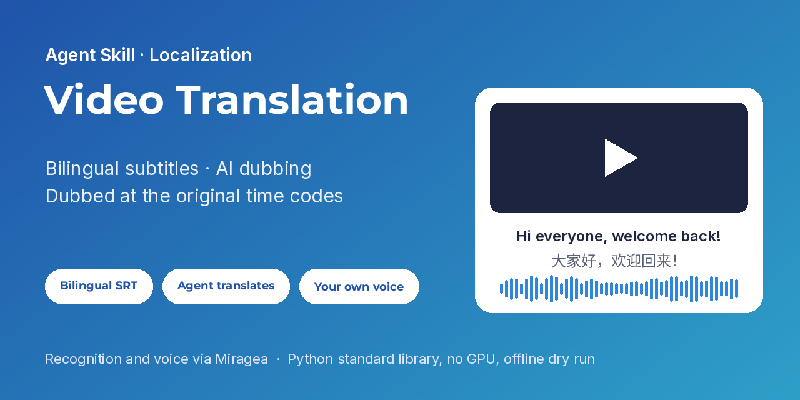
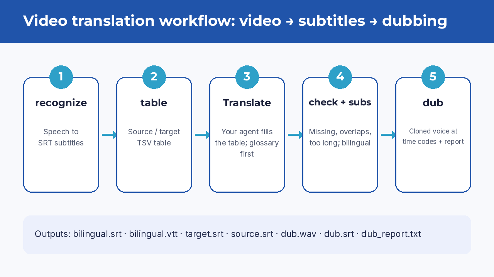

# 视频翻译



视频翻译是一个把视频字幕翻译成双语字幕、再按原时间码配外语的 Agent 技能：给短剧出海、跨境电商和自媒体视频制作者用，语音识别成字幕 → 原文译文对照表交给 Agent 翻译 → 输出中英双语字幕，并可用你自己的克隆音色配英文等外语，本地无需显卡。

- 视频 / 音频 → `source.srt`（官方识别）→ `table.tsv` 原文译文对照表 → Agent 翻译 → `bilingual.srt` / `bilingual.vtt` / `target.srt`
- `check`：漏译、时间重叠、字幕过长、译文念不完提前标出；`fill` 按行写入译文
- `dub --language en`：你自己的克隆音色按原时间码配外语，念不完自动加速，仍超出就顺延并写入报告



## 安装

把本文件夹 `video-translation-dubbing/` 复制到 Agent 的 skills 目录（如 `~/.claude/skills/`、`~/.codex/skills/`），或在技能市场一键安装。完整用法、工作流和 FAQ 见 [SKILL.md](./SKILL.md)。

```bash
python3 scripts/video_translate.py selftest     # 离线自检，不需要 Key
python3 scripts/video_translate.py table examples/source_srt.txt -o vt/table.tsv
```

正式生成需要 Python 3.9+、环境变量 `MIRAGEA_API_KEY` 和账号里你自己的角色（Miragea：https://miragea.ai）。
