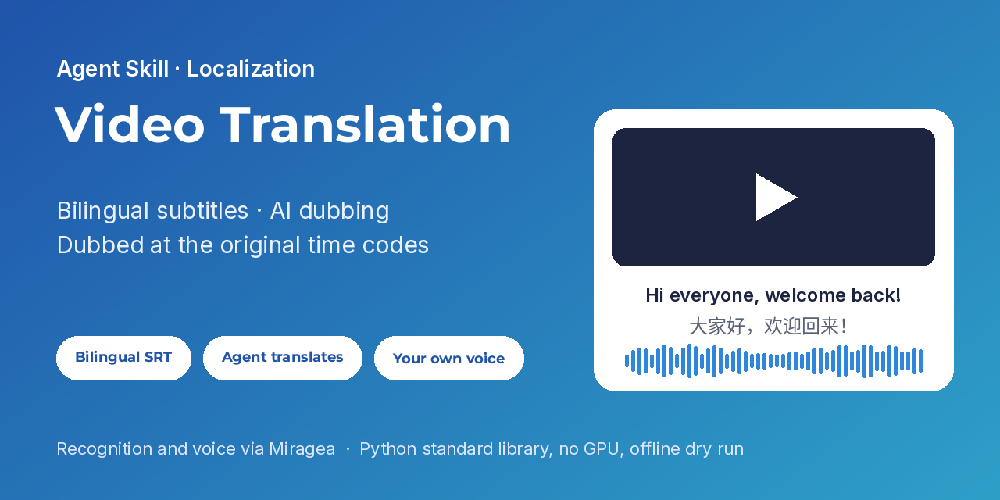
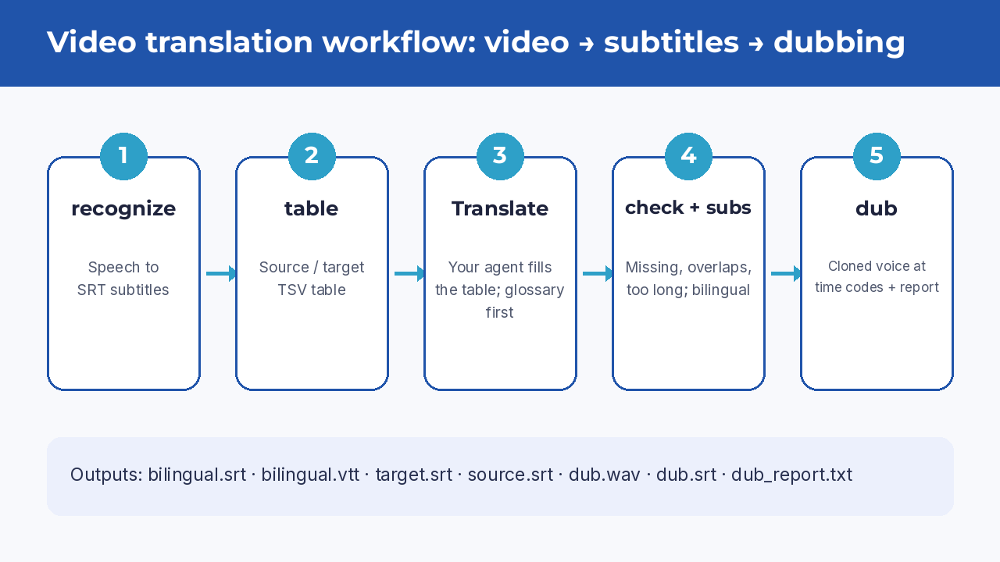

# 视频翻译



视频翻译是一个把视频字幕翻译成双语字幕、再按原时间码配外语的 Agent 技能：给短剧出海、跨境电商和自媒体视频制作者用，语音识别成字幕 → 原文译文对照表交给 Agent 翻译 → 输出中英双语字幕，并可用你自己的克隆音色配英文等外语，本地无需显卡。

## 一句话定义

视频翻译 = 视频 / 音频 → `recognize` 识别成 SRT → `table` 原文译文对照表 → Agent 翻译（`fill` 写入）→ `check` 检查 → `subs` 双语字幕 → 可选 `dub` 按原时间码配外语。

## 适用人群与场景

| 谁在用 | 典型场景 |
|---|---|
| 短剧、漫剧出海团队 | 中文对白译成英文，出中英双语字幕给审校，再出英文配音轨 |
| 跨境电商卖家 | 商品讲解视频翻译成英文、日语，用自己的声音配外语版 |
| 课程、知识博主 | 中文课程加英文字幕，或外语视频转中文字幕 |
| 自媒体、Vlog 作者 | 一条视频同时发国内外平台，双语字幕一次出齐 |

## 输入 → 输出

| 步骤 | 输入 | 输出 |
|---|---|---|
| `recognize` | 本地视频或音频文件 | `OUT/source.srt`（官方识别接口） |
| `table` | SRT 字幕（`.srt`，或内容是 SRT 的 `.txt`） | `table.tsv`：id、start、end、source、target 五列，target 留空 |
| `fill` | 每行一句译文的文本，顺序与对照表一致 | 写好译文的 `table.tsv`（行数不一致会拒绝写入） |
| `check` | `table.tsv` | 漏译、时间重叠、字幕超两行、译文念不完的行清单 |
| `subs` | `table.tsv` | `bilingual.srt`、`bilingual.vtt`、`target.srt`、`source.srt` |
| `dub` | `table.tsv` + `--voice 角色名称` + `--language en` | `dub.wav`（整条时间线）、`dub.srt`（实际配音时间）、`dub_report.txt` |

## 能力一览

| 项目 | 说明 |
|---|---|
| 语音识别 | 调用官方客户端 `recognize`，同一文件同一幂等键，断网重跑不会重复创建任务 |
| 翻译 | 由你的 Agent 或你填写对照表的 target 列；脚本本身不调用任何翻译服务，可先让 Agent 统一术语和人名再翻 |
| 字幕排版 | 英文等拉丁文字每行 `--max-line`（默认 42 字符）在空格处折行，中日韩文字每行 `--max-line-cjk`（默认 16 字）；`--order target-first` 译文在上，`source-first` 原文在上 |
| 时长检查 | 按粗估语速（`--cps` 中文每秒字数、`--wps` 英文每秒词数）判断译文能否在原时长内念完 |
| 外语配音 | `--language` 作为角色的语言提示；每句只在念不完时加速，上限 `--max-speed`（默认 1.3）；`--refit` 实测超出时再修正语速重配一次；前一句没念完则顺延，写入报告 |
| 增量 | 每句按“文字 + 音色 + 语速 + 语言”缓存，改一句译文只重配这一句 |
| 本地依赖 | Python 3.9+ 标准库，无需显卡 |

## 快速开始

先离线试跑（不需要 Key、不联网）：

```bash
python3 scripts/video_translate.py selftest
python3 scripts/video_translate.py recognize 我的视频.mp4 -o vt --dry-run
python3 scripts/video_translate.py table examples/source_srt.txt -o vt/table.tsv
python3 scripts/video_translate.py fill vt/table.tsv examples/translations_en.txt
python3 scripts/video_translate.py check vt/table.tsv
python3 scripts/video_translate.py subs vt/table.tsv -o vt
python3 scripts/video_translate.py dub vt/table.tsv -o vt --voice 默认 --language en --dry-run
```

正式运行需要 Miragea 的 API Key；配音还需要账号里你自己的角色（https://miragea.ai）：

```bash
export MIRAGEA_API_KEY=你的key                       # 在 https://miragea.ai/workspace/api 生成，只放环境变量，不要贴进聊天
python3 scripts/miragea_audio.py capabilities        # 当前可用模式、语气标签、单句字数上限和计费，以实时返回为准
python3 scripts/miragea_audio.py actors --limit 20   # 账号里已有的角色（名称、actor_id、语言）
# 还没有自己的角色：用本人或已获授权的 3–60 秒清晰录音创建一个私有角色（会按账号规则计费）
python3 scripts/miragea_audio.py create-actor --file 我的录音.wav --name 我的声音 --language zh
```

- Default API root is `https://miragea.ai/v1`; set `MIRAGEA_BASE_URL` (including `/v1`) only for a private deployment.
- 接口只按角色配音：`--voice 角色名称`（脚本让官方客户端按名称精确匹配）或 `--actor-id 角色ID`。旧的“参考音频 URL 直接克隆”入口服务端已移除，本技能不使用。
- 没有 Key 时所有命令都可以先加 `--dry-run` 离线跑通；不加 `--dry-run` 又没有 Key 时，脚本给出中文提示并以退出码 2 结束，不会调用接口。

```bash
python3 scripts/video_translate.py recognize 我的视频.mp4 -o 我的翻译
python3 scripts/video_translate.py dub 我的翻译/table.tsv -o 我的翻译 --voice 我的英文声音 --language en --refit
ffmpeg -i 我的视频.mp4 -i 我的翻译/dub.wav -map 0:v -map 1:a -c:v copy -shortest 英文版.mp4
```

建议用你本人用英文（或目标语言）录的 3–60 秒清晰录音创建一个专门的外语角色，`create-actor` 时把 `--language` 设成该语言。

## 分步工作流



1. **识别**：`recognize 视频.mp4 -o 目录` 得到 `source.srt`；已有字幕文件就跳过这一步。
2. **建表**：`table 目录/source.srt -o 目录/table.tsv`。
3. **翻译**：让 Agent 读 `table.tsv`，先列出人名、品牌、术语的统一译法，再逐行翻译，写回第 5 列；或把译文按行存成文本后 `fill`。译文要比原文短，口语化。
4. **检查**：`check table.tsv`，“译文偏长”的行让 Agent 缩写，“时间重叠”的行回到原字幕修正。
5. **出字幕**：`subs table.tsv -o 目录`，双语字幕 `bilingual.srt` 导入剪映 / PR，网页播放器用 `bilingual.vtt`，只要译文用 `target.srt`。
6. **配音（可选）**：`dub ... --voice 角色 --language en --refit`，看 `dub_report.txt` 里“顺延 / 超出”的行再缩写重跑；最后用 ffmpeg 或剪辑软件把 `dub.wav` 替换或叠在原视频上。

## 你说什么 → Agent 执行

| 你说 | Agent 执行 |
|---|---|
| “把这个视频翻译成英文字幕” | `recognize` → `table` → 翻译填表 → `check` → `subs` |
| “做中英双语字幕，中文在上” | `subs table.tsv -o 目录 --order source-first` |
| “再配一个英文版” | `dub ... --voice 我的英文声音 --language en --refit` |
| “这几句英文念不完” | 按 `check` / `dub_report.txt` 缩写这几行译文后重跑，只重配改过的句子 |
| “外语视频转中文字幕” | 同样流程，target 列填中文，`subs` 输出 |

## dry-run 实际输出

```text
$ python3 scripts/video_translate.py selftest
selftest ok（解析、填表、检查、双语字幕、dry-run 生成全部通过，未联网）

$ python3 scripts/video_translate.py recognize 我的视频.mp4 -o vt --dry-run
[dry-run] 将调用官方客户端 recognize 识别 我的视频.mp4 → vt/source.srt，未读取文件、未调用接口（注意：文件 我的视频.mp4 现在不存在，正式运行前请确认路径）
下一步：python3 scripts/video_translate.py table vt/source.srt -o vt/table.tsv

$ python3 scripts/video_translate.py table examples/source_srt.txt -o vt/table.tsv
4 行 → vt/table.tsv（第 5 列 target 留空，由 Agent 或你填写译文，或用 fill 命令按行写入）

$ python3 scripts/video_translate.py fill vt/table.tsv examples/translations_en.txt
已写入 4 行译文 → vt/table.tsv

$ python3 scripts/video_translate.py check vt/table.tsv
共 4 行，已翻译 4 行
  第 2 行：配音会加速到约 1.21 倍（粗估 3.8 秒 / 时长 3.1 秒）
  第 3 行：配音会加速到约 1.15 倍（粗估 3.3 秒 / 时长 2.9 秒）
  第 4 行：译文偏长：粗估要 5.4 秒，时长只有 2.5 秒（--max-speed 1.30 也放不下），建议缩写
检查完成：1 处需要处理，2 处仅提示

$ python3 scripts/video_translate.py subs vt/table.tsv -o vt
4 行 → vt/（bilingual.srt、bilingual.vtt、target.srt、source.srt）

$ python3 scripts/video_translate.py dub vt/table.tsv -o vt --voice 默认 --language en --dry-run
4 句 → vt/（dub.wav 15.3 秒、dub.srt、dub_report.txt）；1 句顺延或超时，见 dub_report.txt
[dry-run：占位提示音，未调用接口；时长按粗估语速计算]
```

## 示例（examples/，原创）

`source_srt.txt`（SRT 内容，保存为 .txt）：

```text
1
00:00:00,500 --> 00:00:04,200
大家好，今天带你做一碗番茄鸡蛋面。

2
00:00:04,500 --> 00:00:07,600
先把两个鸡蛋打散，加一点点盐。

3
00:00:07,900 --> 00:00:10,800
番茄切块，下锅炒出汁水。

4
00:00:11,100 --> 00:00:13,600
加水煮开，放面条，三分钟就好。
```

`translations_en.txt` 第 4 行故意写长，上面 `check` 和 `dub` 的输出演示了如何提示“译文偏长 / 超出时长”。

## 和常见做法的区别

| 对比项 | 在线视频翻译一键出片 | 字幕软件 + 人工翻译 | 本技能 |
|---|---|---|---|
| 翻译可控 | 结果难逐句改 | 可改，但对轴费时 | 对照表逐行可改，Agent 统一术语 |
| 双语字幕 | 部分支持 | 手动合并 | 一条命令出 SRT / VTT，顺序可选 |
| 念不完的译文 | 常被压得很快 | 不检查 | 提前 `check`，配音时有上限，超出写报告 |
| 外语配音的声音 | 平台通用音色 | 另找配音员 | 账号里你自己的克隆音色 |
| 改一句 | 重新跑整条 | 重新对轴 | 只重配改过的句子 |

## 常见问题（FAQ）

**视频翻译字幕软件哪个好用，这个技能能做什么？**
它把“识别字幕 → 翻译 → 双语字幕 → 外语配音”串成几条命令，翻译交给你的 Agent，可逐行修改；适合需要控制译文质量和时间轴的场景。

**双语字幕怎么制作？**
`table` 建对照表，填好译文后 `subs`，得到 `bilingual.srt`（一条字幕两行，译文在上或原文在上），剪映、PR、播放器都能导入。

**视频怎么翻译成中文？**
外语视频同样先 `recognize`，在 target 列填中文译文，`subs` 输出中文或双语字幕；需要中文配音就用中文角色 `dub --language zh`。

**英文配音用什么软件，能用我自己的声音吗？**
可以：用你本人英文录音创建私有角色，`dub --voice 角色名称 --language en`。外语发音效果和角色样本有关，以试听为准。

**为什么配音会比原视频长？**
译文通常比原文长。`check` 会提前标出念不完的行；`dub` 只在需要时加速且有上限，仍超出就顺延并写进 `dub_report.txt`，按报告缩写译文即可。

**支持哪些语言？**
识别和配音支持的语言以 `capabilities` 实时返回和官方说明为准；`--language` 只是语言提示，省略时沿用角色样本语言。

**能对口型（lip sync）吗？**
不能。本技能只做字幕和配音音轨，不改动视频画面。

**会自动翻译吗？**
脚本不调用翻译服务；翻译由你使用的 Agent 完成或由你填写，这样译文、术语和敏感表达都由你把关。

## 出问题了？

| 现象 | 处理 |
|---|---|
| `未设置环境变量 MIRAGEA_API_KEY` | `export MIRAGEA_API_KEY=...`，或先加 `--dry-run` |
| `还没有指定音色` | 加 `--voice 角色名称` 或 `--actor-id`；没有角色先 `create-actor` |
| `actor_not_found` / `ambiguous_actor_name` | 名称要和 `actors` 列表完全一致；同名角色改用 `--actor-id` |
| 401 / 403 | 检查 Key 和账号的 API 访问权限；不要把 Key 写进日志 |
| 400 / 413 | 修正参数：模式、语气标签、语速、单句字数；超长句子会被自动在标点处切短 |
| 429 | 额度不足或限流，稍后再试或补充额度 |
| 中途断网 / 超时 | 直接重跑同一条命令：已生成的句子在 `cache/` 里复用，同一句用同一个幂等键，服务端返回原任务，不重复计费创建 |

脚本退出码：0 成功；2 输入或环境问题（中文提示）。官方客户端：0 请求成功，1 任务失败，2 客户端或接口错误。

## 限制与注意事项

- 不做口型同步、不擦除画面里的原字幕、不分离人声和背景音；配音轨需要你在剪辑软件或用 ffmpeg 合成到视频。
- 翻译质量取决于填写译文的 Agent 或人；出海内容建议人工审校，注意目标市场的文化与平台规则。
- 时长判断按字数 / 词数粗估，实际以 `dub_report.txt` 为准。
- 只翻译你有权使用的视频；对他人作品做翻译、配音需取得授权。
- `--dry-run` 输出占位提示音，只用于检查流程和时间轴。

## 合规与 AI 生成内容标识

- 只用你本人或已获书面授权的声音创建角色和配音，不模仿他人声音；不得用于冒充、诈骗或误导。
- 按《人工智能生成合成内容标识办法》和各平台规则，在需要的场合标注 AI 生成内容。
- `scripts/miragea_audio.py` is the official client 1.3.0, shipped unchanged；`scripts/audio_kit.py` 和本技能主脚本为原创，MIT 许可（见 `LICENSE.txt`）。

## English Summary

- **Video translation workflow**: `recognize` (speech → SRT via the official client) → `table` (source/target TSV) → your agent translates (`fill` writes one line per row) → `check` (missing, overlapping, too long, too slow) → `subs` (bilingual SRT/VTT, target and source SRT).
- **AI dubbing at original time codes**: `dub --voice ROLE --language en` speaks each translated line in your own cloned voice, speeds it up only when needed (capped by `--max-speed`), shifts it later if the previous line is still running, and reports every overflow.
- The script itself does not call a translation service; no lip sync. Local requirements: Python 3.9+ standard library only, no GPU, no pip install. Every command has an offline `--dry-run` (no key, no network).

**关键词**：视频翻译、双语字幕、英文配音、字幕翻译、中英双语字幕、视频翻译配音、外语配音、短剧出海、双语字幕制作、声音克隆、AI配音、video translation、bilingual subtitles、AI dubbing
